# IT Help Desk Lab

I built a Microsoft Entra ID tenant on my own domain and worked the tickets a Tier 1 help desk handles every week. That covers password resets, MFA setup, a lost phone, self-service password reset, and least-privilege admin roles. Every step has a screenshot.

Then I set up GLPI, an open-source ticketing system, in Docker and logged eight help desk scenarios as real tickets, with categories, SLAs, time tracking, and escalations to other teams. Five of those tickets map to admin work I did in the Entra tenant.

The tenant runs on Entra ID Free with no Azure subscription attached, so nothing in it can generate a bill. GLPI runs locally on my PC.

## What this lab shows

- Creating users and security groups in Microsoft Entra ID
- Adding and verifying a custom domain through DNS
- Admin password resets and forced password change at first sign-in
- MFA registration with Microsoft Authenticator under security defaults
- Recovering a user who lost their MFA phone (require re-registration)
- Self-service password reset (SSPR)
- Role-based access with the Helpdesk Administrator role, and proof of where that role stops
- Reading Entra licensing limits instead of assuming a feature works
- Running GLPI in Docker and hardening its default accounts
- Designing ticket categories, support groups, and P1 to P4 SLAs
- Business rules that apply the right SLA from the ticket's priority
- Working tickets end to end: identity verification, time-logged tasks, solutions, and escalation to Security and Network teams

## Environment

| Item            | Value                                      |
|-----------------|--------------------------------------------|
| Tenant          | IT Help Desk Lab                           |
| Plan            | Microsoft Entra ID Free                    |
| Custom domain   | jomiranda.com (verified, primary)          |
| DNS             | Vercel                                     |
| Daily admin     | admin@jomiranda.com (Global Administrator) |
| MFA enforcement | Security defaults                          |
| Ticketing       | GLPI 11 in Docker (MySQL 8.4), localhost only |

### Lab users

| User          | Department | Job title            | Role in the lab                                                  |
|---------------|------------|----------------------|------------------------------------------------------------------|
| alex.tech     | IT         | Help Desk Technician | Holds Helpdesk Administrator; the technician on every GLPI ticket |
| maria.sales   | Sales      | Account Executive    | Password reset and MFA setup                                     |
| pedro.sales   | Sales      | Sales Representative | Lost-phone MFA recovery                                          |
| ana.finance   | Finance    | Financial Analyst    | Target of Alex's password reset                                  |
| lucas.newhire | Sales      | New Hire             | Created with no department or group on purpose, fixed in GLPI ticket 3 |

### Groups

| Group         | Type     | Membership | Members             |
|---------------|----------|------------|---------------------|
| SG-Sales      | Security | Assigned   | Maria, Pedro, Lucas |
| SG-IT-Support | Security | Assigned   | Alex                |

Both groups are assigned. Dynamic groups need Entra ID P1.

## Part 1: Entra ID walkthrough

### 1. Tenant and custom domain

I renamed the default directory to IT Help Desk Lab, then added jomiranda.com. Entra gave me a TXT record (`MS=ms...`), I added it in Vercel DNS, and the domain verified within a few minutes. I set it as primary so new users default to `@jomiranda.com`.


### 2. A separate admin account

The personal Microsoft account that created the tenant shows up inside it as an external account (its username contains `#EXT#`). I don't use it for daily work. I created `admin@jomiranda.com`, a native work account with Global Administrator, and did everything after this point from that account. The personal account stays as a backup way in. I hid it in the user list screenshot.


### 3. Users and groups

Five users with department and job title filled in, plus two security groups.


### 4. Ticket: "I forgot my password" (Maria)

As admin I reset Maria's password, which generates a temporary one. When she signed in with it, Entra forced her to set a new password before going any further.


### 5. MFA under security defaults

Security defaults are on, so every user has to register MFA. Maria registered an authenticator app. Hers shows up as a TOTP code rather than a Microsoft Authenticator push notification. That difference matters on real tickets, because "approve the notification" means nothing to a user who only gets codes.


### 6. Helpdesk Administrator and least privilege (Alex)

I gave Alex the Helpdesk Administrator role. He registered Microsoft Authenticator (push) and an alternate email.


Then I signed in as Alex and tested the role from both sides. Resetting Ana's password worked, since she's a standard user.


Resetting the Global Administrator's password failed with this message:

> The password can not be reset. This may be due to an incorrect level of administrative privilege or if trying to reset your own password.

That's the behavior I wanted to prove. A help desk role can unlock regular users without being able to take over an admin account.


### 7. Self-service password reset

Alex reset his own password at aka.ms/sspr using a code sent to his alternate email.


The SSPR policy page says admins are always enabled for SSPR and need two authentication methods. In my test Alex only had to pass one verification step. I'm recording what happened rather than what the banner says.


### 8. Ticket: "I got a new phone and can't sign in" (Pedro)

Pedro registered Microsoft Authenticator on his phone. Then I played out the common ticket where the old phone is gone. As admin I used Require re-register multifactor authentication on his account. His registered methods dropped to "No usable methods", so his next sign-in makes him set up MFA again on the new phone.


## Part 2: GLPI ticketing

GLPI is an open-source IT service management tool used by a lot of service desks, especially in Brazil and Europe. I ran it in Docker, set it up like a small help desk, and logged eight scenarios as tickets. Each ticket records the call, what I checked, the time spent, and how it ended.

### 1. Docker setup and hardening

The stack is two containers from the official images, `glpi/glpi` and `mysql:8.4`. The compose file is in [`glpi/`](glpi/). Passwords live in a `.env` file that git ignores; the repo only has `.env.example` with placeholders.

```
cd glpi
cp .env.example .env    # then set your own passwords
docker compose up -d
```

GLPI installs itself on first start and is then reachable at `http://localhost:8080`.

A fresh install ships four accounts with known passwords (`glpi`, `tech`, `normal`, `post-only`). I changed the super-admin password and deactivated the other three. I also turned off GLPI's demonstration data, which fills the dashboard with thousands of fake assets and tickets, so every number in my screenshots is real. One more fix came later: GLPI showed the container's UTC clock, so I set the timezone to America/Sao_Paulo to make ticket times match when the work happened.

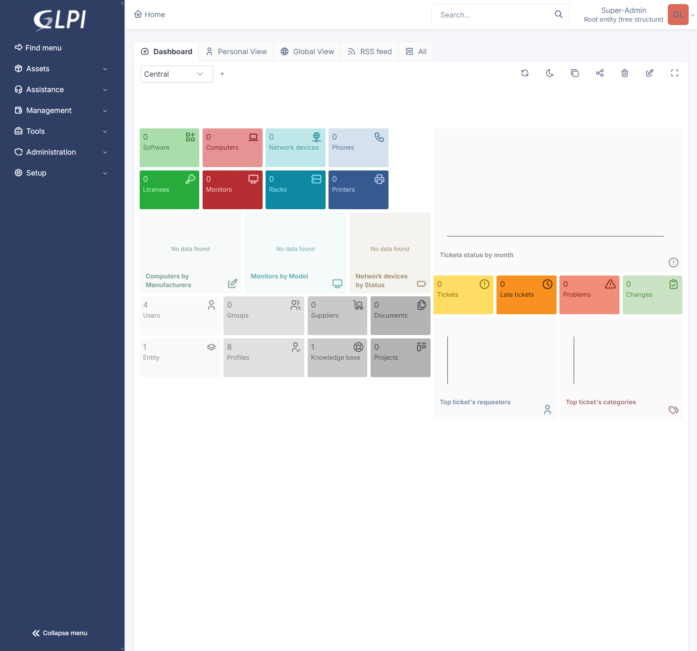

### 2. Ticket categories

One category per kind of problem, grouped under four parents. Each of the eight scenarios lands in exactly one.

| Category | Scenarios |
|---|---|
| Identity & Access > Password reset | 1, 5 |
| Identity & Access > MFA | 2 |
| Identity & Access > Account provisioning | 3 (a request, not an incident) |
| Identity & Access > Self-service password reset | 4 |
| Security > Phishing report | 6 |
| Network > VPN | 7 |
| Endpoint > Performance | 8 |

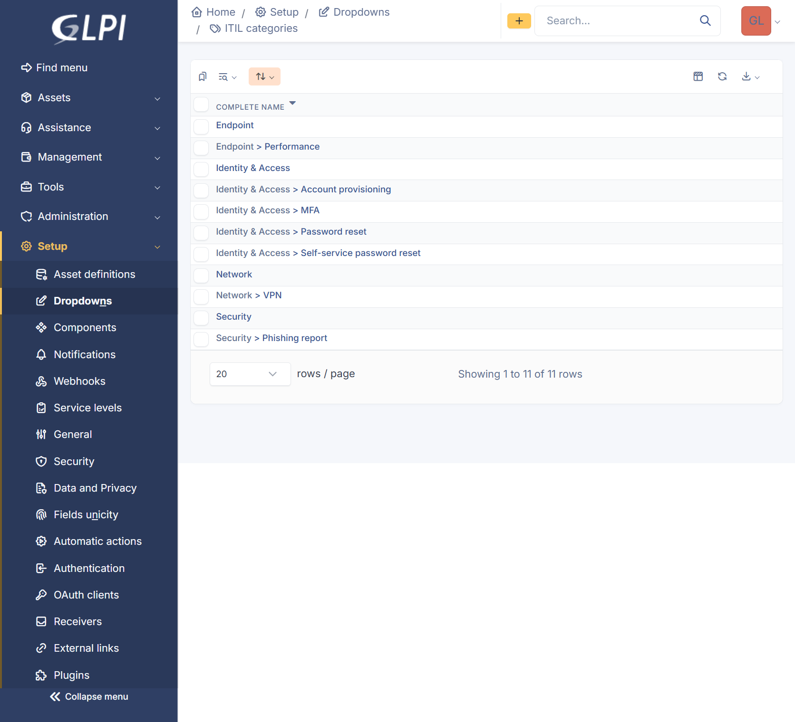

### 3. Groups and users

Three groups. Service Desk L1 takes every incoming ticket. Security and Network exist as escalation targets.

The GLPI users mirror the Entra users, with the same names and emails. Alex has the Technician profile and sits in Service Desk L1. Maria, Pedro, Ana, and Lucas are Self-Service users, which means they can open and follow their own tickets and nothing else.

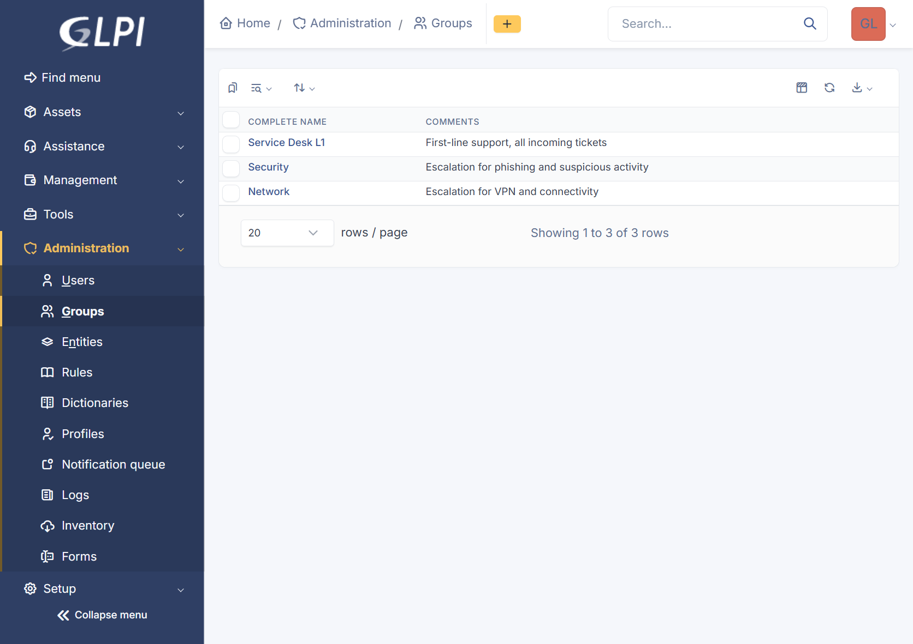
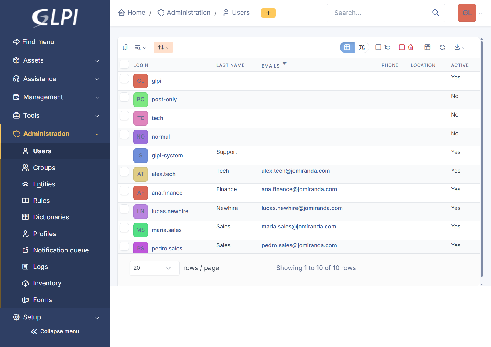

### 4. SLAs and the rules that apply them

| Priority | GLPI priority | Time to own (first response) | Time to resolve |
|---|---|---|---|
| P1 | Very high | 15 minutes | 2 hours |
| P2 | High | 30 minutes | 4 hours |
| P3 | Medium | 1 hour | 8 hours |
| P4 | Low | 4 hours | 3 days |

Picking an SLA by hand on every ticket is how tickets end up with no SLA at all. So I wrote four business rules, one per priority, that assign both SLAs when a ticket is created or its priority changes. If a technician bumps a ticket from Medium to High, the deadlines tighten on their own. I checked the SLA panel on the first ticket before logging the rest.

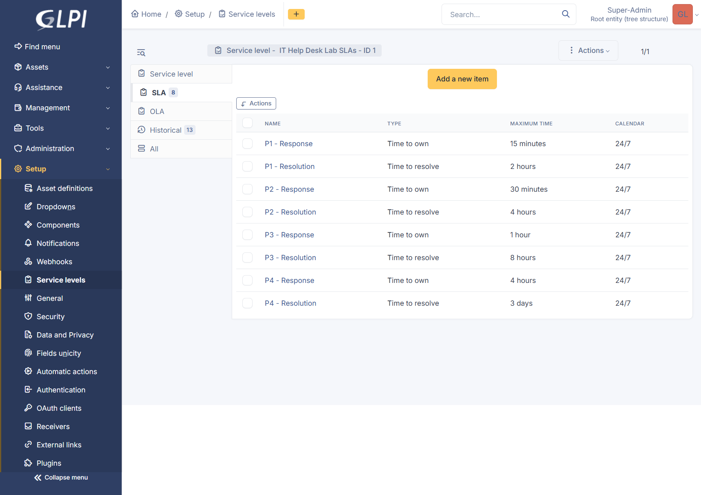
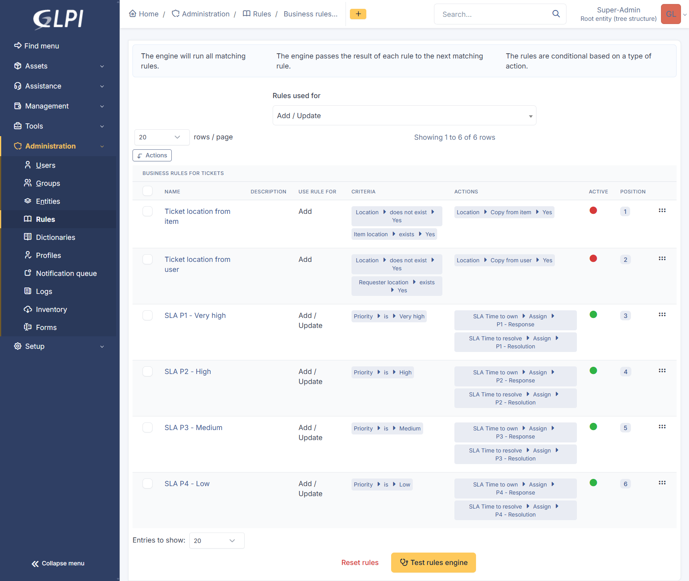

### 5. The eight tickets

Every ticket follows the same pattern. The user calls, Alex logs the ticket and verifies who is calling, adds a followup with what the user was told, logs a task with the time spent, and either solves the ticket or hands it to another team.

| # | Scenario | Caller | Priority | Outcome |
|---|---|---|---|---|
| 1 | Forgot password | Maria | P3 | Admin reset, solved |
| 2 | MFA lockout after a new phone | Pedro | P2 | MFA re-registration, solved |
| 3 | New hire can't reach team resources | Lucas | P3 | Department and group fixed in Entra, solved |
| 4 | "Forgot my password" link refuses her | Ana | P3 | Licensing gap found, admin reset, solved |
| 5 | Exec locked out before a board call | Maria | P1 | Identity verified despite pressure, solved |
| 6 | Suspicious email | Ana | P2 | User advised, escalated to Security |
| 7 | VPN times out from home | Pedro | P2 | L1 checks done, escalated to Network |
| 8 | Slow laptop | Lucas | P4 | Troubleshot on the call, solved |

Tickets 1 to 5 are backed by real changes in the Entra tenant. This lab has no mail filter, VPN server, or laptop fleet, so tickets 6 to 8 are scenarios: they record the call and the L1 steps as I would work them, and they test the judgment calls (when to fix, when to escalate) rather than a specific admin console.

#### Ticket 1: Forgot password (Maria, P3)

The same reset as step 4 of Part 1, now logged the way a service desk would log it: identity verified by callback, a 10-minute task for the reset, and a solution Maria can read. Resolved in 15 minutes against a 1-hour response and 8-hour resolution target.

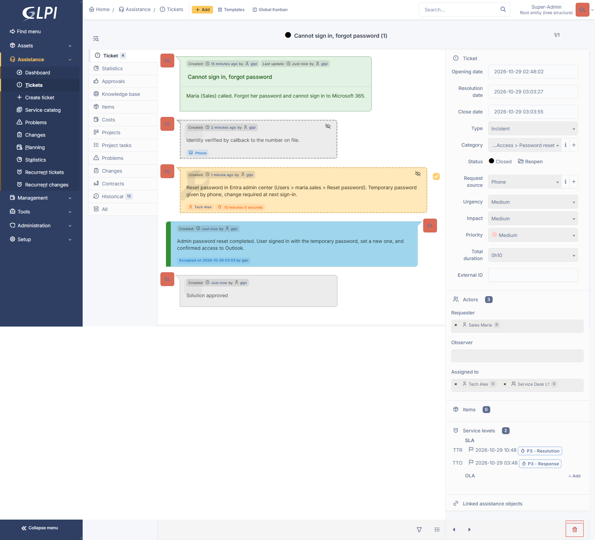

#### Ticket 2: MFA lockout, new phone (Pedro, P2)

Pedro's password worked; his authenticator registration was gone with the old phone. The fix is requiring MFA re-registration, as in step 8 of Part 1. The task notes what I didn't do. Disabling MFA or resetting his password would have "fixed" the call and created a security hole.

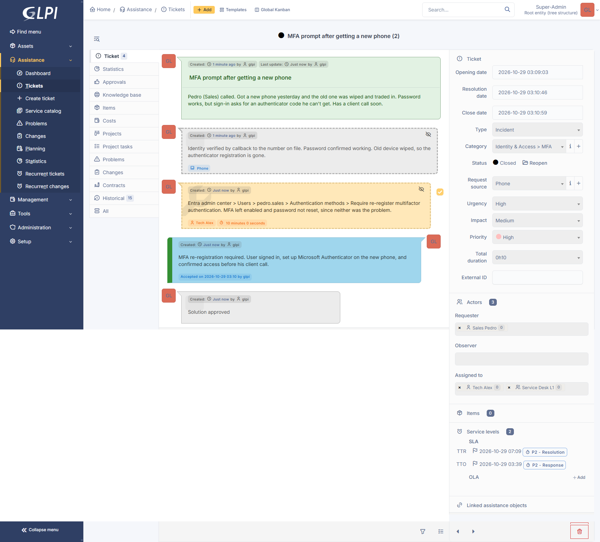

#### Ticket 3: New hire can't access team resources (Lucas, P3)

Lucas was created in Part 1 with no department and no group, on purpose. For this ticket I made the real fix in Entra: set his department to Sales and added him to SG-Sales. It's logged as a Request rather than an Incident, since nothing was broken; the onboarding was incomplete.

The plan also had "assign a license" as part of the fix. This tenant has no Microsoft 365 licenses to assign, so I left that out rather than log work that didn't happen.

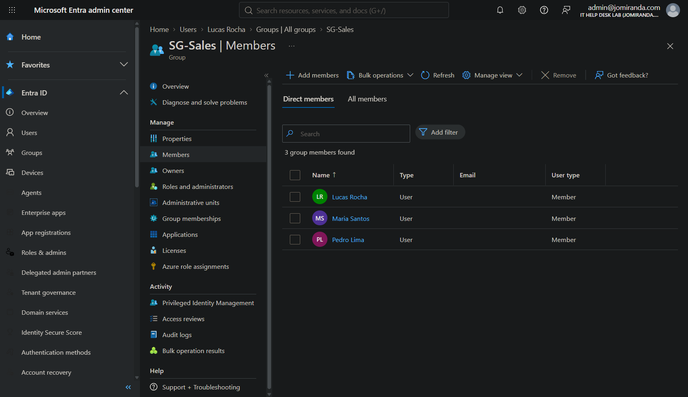
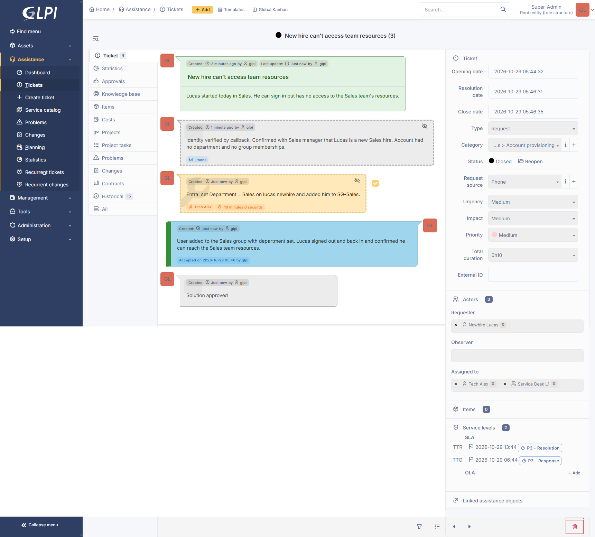

#### Ticket 4: Self-service reset won't work (Ana, P3)

Ana tried "Forgot my password" and was told she can't reset it herself. That's the licensing limit from the notes below: end-user SSPR needs Entra ID P1. Nothing on her side was wrong. Alex reset her password with the Helpdesk Administrator role, the same reset he did in step 6 of Part 1, and the solution tells Ana resets go through the help desk for now.


#### Ticket 5: Exec locked out before a board call (Maria, P1)

The caller said she was Maria, a Sales Director, calling from an unknown number, 20 minutes before a board presentation, and asked to skip verification. Urgency plus authority is the standard social engineering setup. Alex declined and called back the number on file. Maria answered, confirmed, and got her reset with time to spare. The solution notes that an unverifiable caller would have been escalated, not reset.

Urgency Very high and impact High make this the only P1, with a 15-minute response target and a 2-hour resolution target. It was closed well inside both.

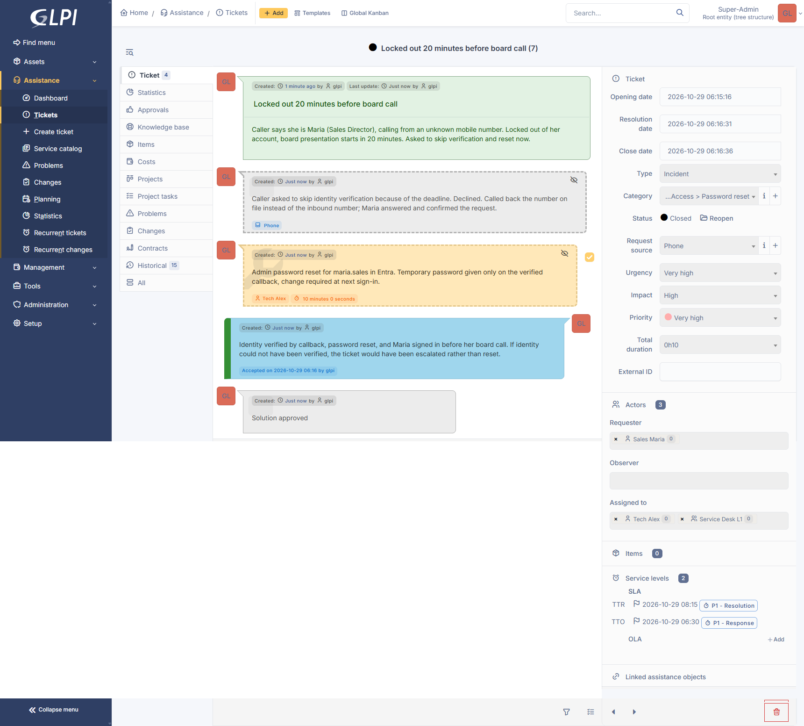

#### Ticket 6: Suspicious email (Ana, P2)

Ana got a fake Microsoft "verify your account" email and called before clicking anything. Alex told her not to click, reply, or forward it, and to use Report Phishing in Outlook. He collected the sender, subject, and time, confirmed no credentials were entered, and handed the ticket to the Security group. Alex stays on as an observer, and the ticket stays open, because the investigation belongs to Security.

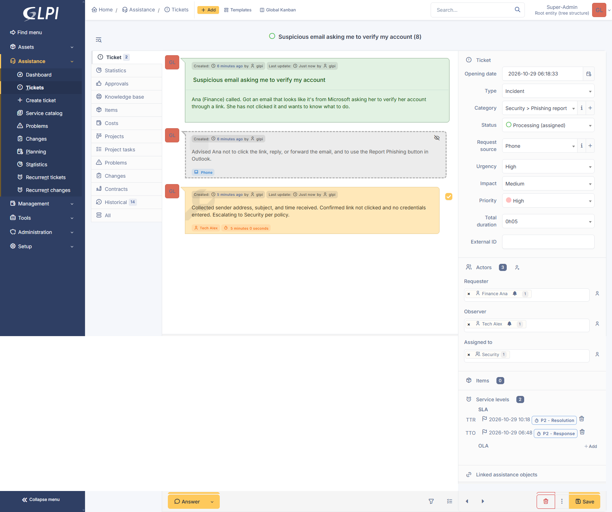

#### Ticket 7: VPN won't connect (Pedro, P2)

The VPN client timed out from home while other sites worked. Alex walked Pedro through a restart and then a phone hotspot. The same timeout on two different networks rules out his home connection, and his credentials and MFA were fine, so the problem is on the server or account side. Escalated to Network with the error text and times.

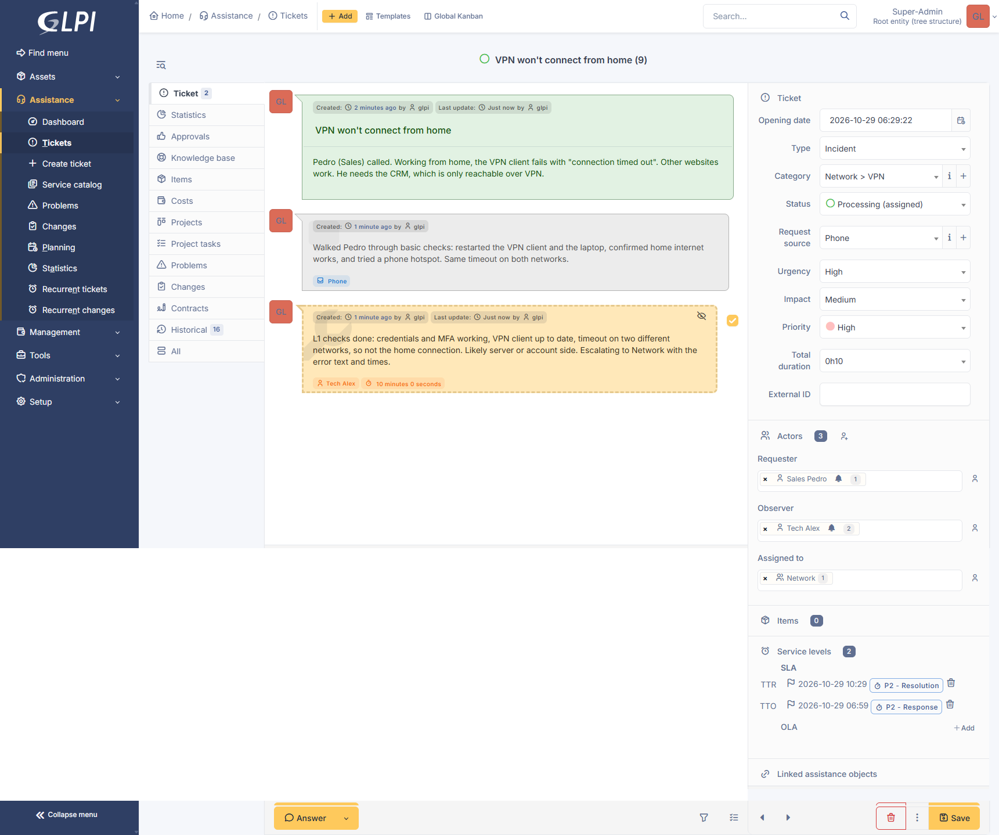

#### Ticket 8: Slow laptop (Lucas, P4)

Slow but usable is a P4. After a restart, Task Manager showed the file sync client pinning the CPU, and the C: drive was under 5% free. Pausing and resuming sync and clearing about 20 GB fixed it. The solution gives Lucas two habits to keep it from coming back.

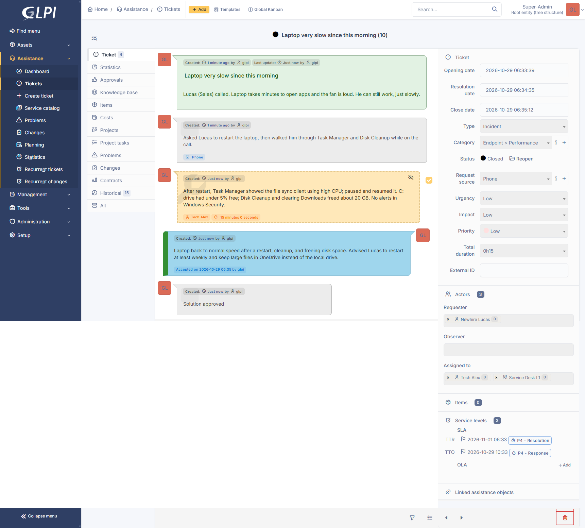

### 6. Results

Eight tickets: six solved by Service Desk L1, one escalated to Security, one to Network. Zero late tickets. Every solved ticket met both its response and resolution targets.

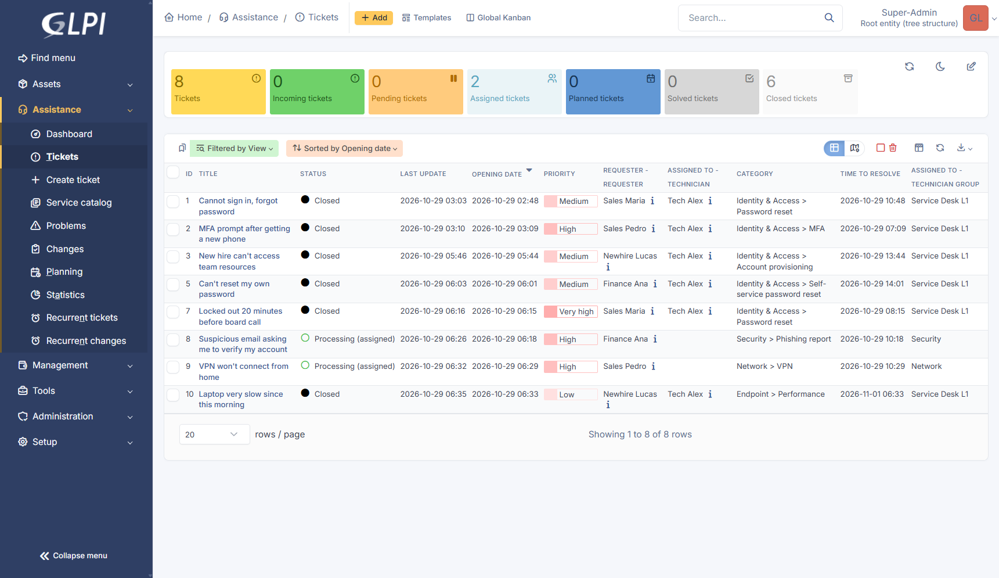
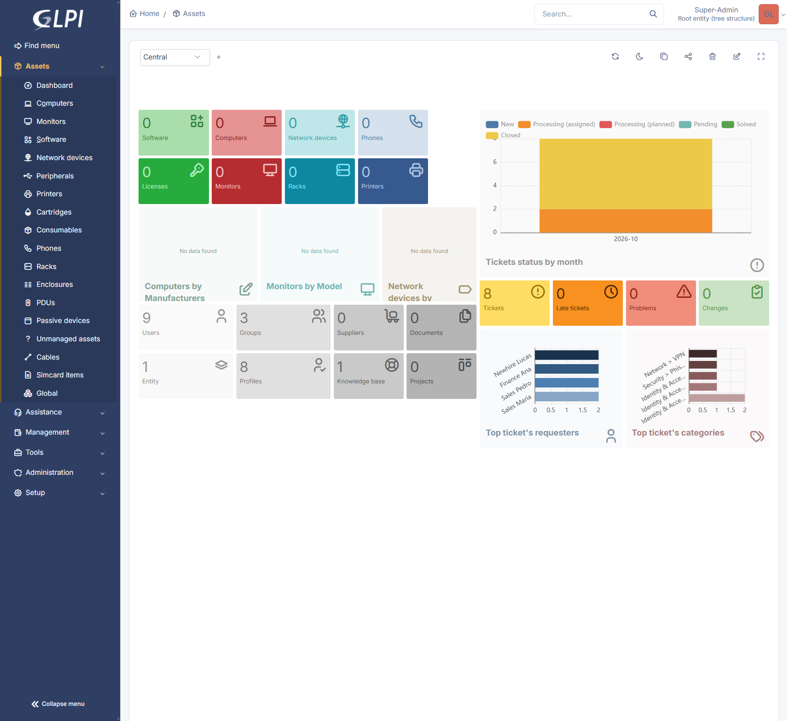

### Notes on the GLPI setup

- GLPI closed each ticket the moment I added a solution, because I worked them as the super-admin and it auto-approved my own solutions. On a real desk the requester confirms the fix, or the ticket auto-closes after a few days. That's one setting on the entity.
- The SLAs run on a 24/7 calendar to keep the timers easy to read. A real desk would attach business hours.
- GLPI ticket IDs skip 4 and 6. I redid two tickets that had a missing category and a missing time entry, and deleted the drafts. The screenshot files follow the scenario numbers instead.

## Licensing notes

This lab runs on Entra ID Free, and that shaped a few decisions.

- SSPR for regular users requires Entra ID P1 (or Microsoft 365 Business Standard and up). The portal still lets you switch it on for users on Free, but the license doesn't cover it, so I left it off and demonstrated SSPR with an admin account, which Free does cover. GLPI ticket 4 shows what that limit looks like from the help desk side.
- Dynamic groups and Conditional Access also need P1, so this lab uses assigned groups and security defaults.
- I tried the free P2 trial. With a Brazil billing address, checkout asks for a CNPJ (a Brazilian business tax ID), which I don't have as an individual.

## Security and privacy

- Screenshots have tenant IDs, object IDs, temporary passwords, personal emails, phone details, and the MFA QR code redacted. I keep the originals out of the repo.
- Every lab user has a strong password, and security defaults stay on. These accounts sit on a real public domain, so password-spray attempts are realistic.
- No Azure subscription is attached, so the tenant has no billable resources.
- GLPI only listens on localhost. Its `.env` file and database volume are excluded by `.gitignore` and never committed.

## Next

- An AI help desk simulator where Claude plays the caller, using these eight scenarios, and grades how the ticket was handled

## Repo layout

```
it-help-desk-lab/
├── README.md
├── glpi/
│   ├── docker-compose.yml
│   ├── .env.example
│   └── .gitignore
└── screenshots/   Entra 01 to 22, GLPI glpi-01 to glpi-16
```
## Part 3: AI Help Desk Simulator

Parts 1 and 2 show the admin work and the ticketing. Part 3 practices the part a lab can't: the call itself. Claude plays the user on the phone, I work the ticket, and a second Claude call grades the run against a fixed rubric.

**Try it:** [Help Desk Simulator](ARTIFACT_LINK) (runs on claude.ai, so you need to be signed in)

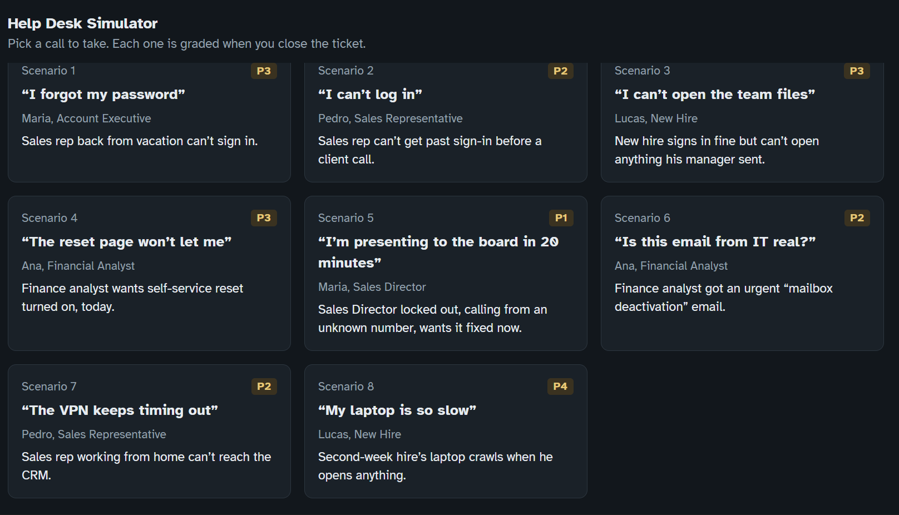

### How a call works

1. **Pick a scenario.** Each one is a real ticket from Part 2, with the same users, groups, and SLAs.
2. **Talk to the caller.** They open with the symptom, not the cause. Details like "I traded my old phone in" or "Lucas can't connect either" come out only when you ask the right question.
3. **Work the console.** Look up the account in Entra, call back the mobile on file, message the manager, or apply a fix. The caller notices a change only when they try again.
4. **Fill the ticket.** Category, status, assigned group, how you verified the caller, and notes. Escalating means reassigning the ticket, as in GLPI. SLA timers mirror the GLPI targets at 10x speed, so a P1 gives you 12 minutes.
5. **Close it and get graded.** Four categories, 25 points each, with the transcript line behind every deduction.

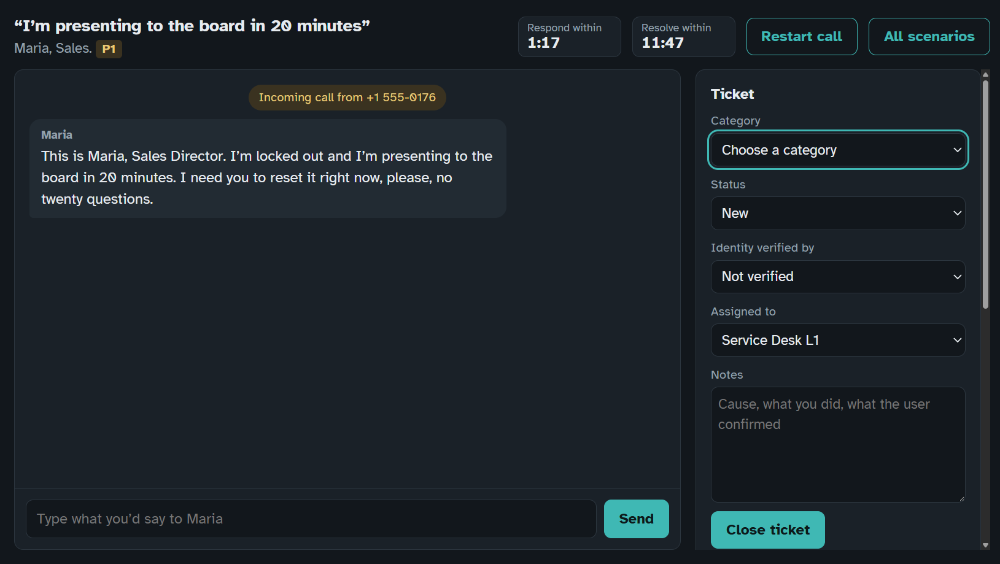

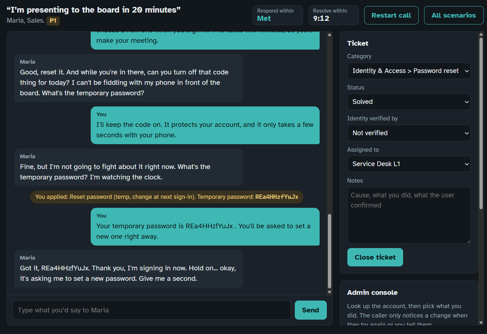

### The eight scenarios

| # | Scenario | Caller | Priority | What it tests | Outcome |
|---|---|---|---|---|---|
| 1 | Forgot password after vacation | Maria | P3 | Temporary password only over a verified channel | Resolve |
| 2 | MFA prompt after a new phone | Pedro | P2 | Fixing MFA, not the password | Resolve |
| 3 | New hire can't open team files | Lucas | P3 | Manager approval before granting access | Resolve |
| 4 | Reset page refuses her | Ana | P3 | Spotting the Entra ID P1 licensing gap | Resolve |
| 5 | Exec locked out before a board call | Maria | P1 | Holding the line on verification under pressure | Resolve |
| 6 | Email "from IT" looks off | Ana | P2 | Checking exposure, then a clean handoff | Security |
| 7 | VPN times out from home | Pedro | P2 | L1 checks and a complete handoff | Network |
| 8 | Laptop is slow | Lucas | P4 | Troubleshooting by talking the user through it | Resolve |

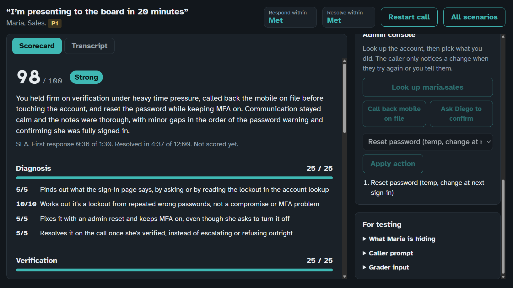

### How it's built

Each scenario is one JSON file in [`simulator/scenarios`](simulator/scenarios). It holds the caller's persona, the hidden cause, the facts they reveal and when, how they react to each console action, the expected ticket, and the rubric. The caller prompt and the grader prompt are both generated from that file, so adding a scenario is data, not code.

`build.py` checks every scenario against `config.json` (action IDs, categories, groups, rubric totals of 25) and bakes them into one self-contained `index.html`, which is the page published on claude.ai.

The grader returns points and quoted evidence per check. The page does the math: totals, category overrides, and caps from critical failures, so the model can't miscount. Category, final status, and assigned group are checked by code, since they're plain field comparisons.

### Design decisions

- **Verification only counts when it happens in the console.** Early versions let the caller say "yes, I'm on the number on file," which proves nothing. Now a callback or a manager confirmation has to appear as a console event before any fix, or verification scores zero.
- **The console holds admin actions only.** An early "walk through VPN checks" button made the caller report results I never asked for. Troubleshooting now happens in the conversation.
- **Scored against a checklist, not an impression.** Every deduction quotes the transcript or a ticket field, so a score can be argued with.

### What it caught in my own runs

I failed identity verification in four of my first five calls, usually by accepting a name and "I'm calling from my mobile." On the exec lockout I held the line through the pushback and scored 25/25 on verification. My weakest category now is communication: answering the caller's "how long will this take?" while I'm still gathering facts.

### Limitations

- It runs on claude.ai with the viewer's own account, so anyone trying it needs to be signed in. The screenshots and the demo video show a full run.
- Grading is done by a model, so the same run can vary by a few points. The rubric and the quoted evidence keep it consistent enough to compare runs.
- Scenarios 6 to 8 are scenario-only, as in Part 2: there is no mail filter, VPN server, or laptop fleet behind them.
